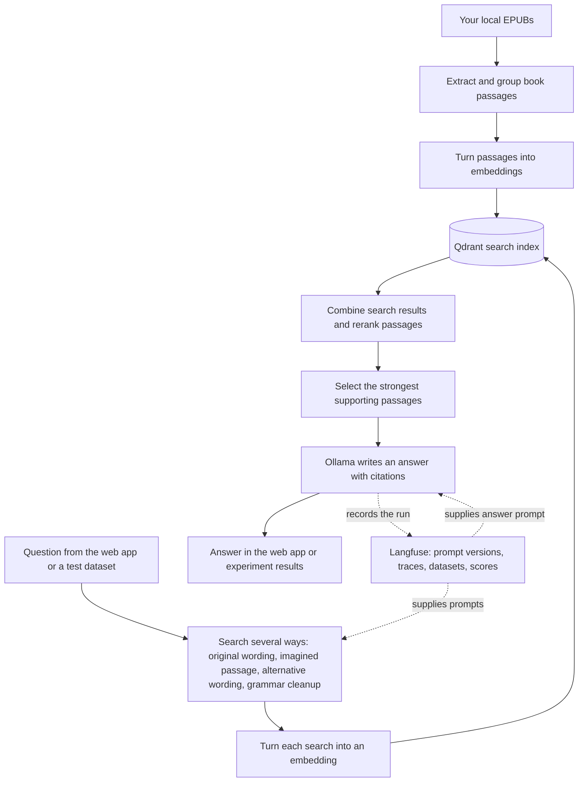

# Millennium semantic search

Ask questions about Stieg Larsson's *Millennium* trilogy and find answers grounded in the books. This project searches passages from locally supplied EPUBs, chooses the most relevant evidence, and uses a local language model to write an answer with citations. You can inspect the cited passages and the steps that produced the answer.

The book files are **not included** in this repository. The app builds its search index from EPUBs you place in the local `corpus/` directory.

## How it works

**Semantic search** looks for passages with a similar meaning to the question, even when the wording differs. The app also tries several ways to phrase a search. One route asks the model to imagine what a useful passage might say (HyDE); another generates alternative searches. A grammar-corrected version can catch awkward wording. When a name is incomplete, the app can search using the fuller name found in the books.

The searches are combined, then a second model checks which passages best match the question. If the first set looks weak, the pipeline can consider a wider pool and give the answer model more context. The final answer is based on the selected passages and cites them so you can check it against the source. The same pipeline can also run in simpler modes to show which search methods help.

## What Langfuse does here

Langfuse is the project's workspace for **prompts, traces, and experiments**:

- **Prompts:** The instructions for search rewrites and answers are versioned in Langfuse. A run pins the versions it used, so later prompt edits do not change that run's record.
- **Traces:** Each question records its search steps, retrieved passages, reranking, answer, and timing. The web app can show the trace for a question and send a helpfulness rating.
- **Experiments:** A question-and-answer dataset can be run through different pipeline settings. Langfuse links each answer to its trace and scores answer correctness and citation support, making runs easier to compare. Reference answers are used for evaluation, never to generate the answer.

Langfuse helps explain *why* an answer changed when a prompt or search setting changes. The actual book search runs through Qdrant, and the language model calls run through Ollama.

## Explore the project

The Vue web app is for asking questions. The Python API handles indexing, search, answers, and experiment runs. See the [technical guide](TECHNICAL_GUIDE.md) for setup and configuration, the [frontend guide](frontend/README.md) for the UI, and the [improvement log](IMPROVEMENTS.md) for examples of how the pipeline was tuned.
