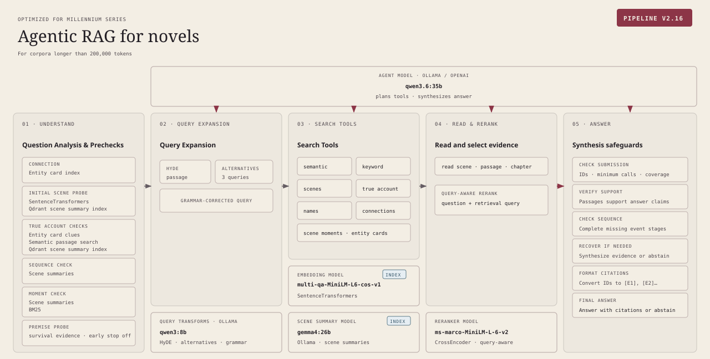
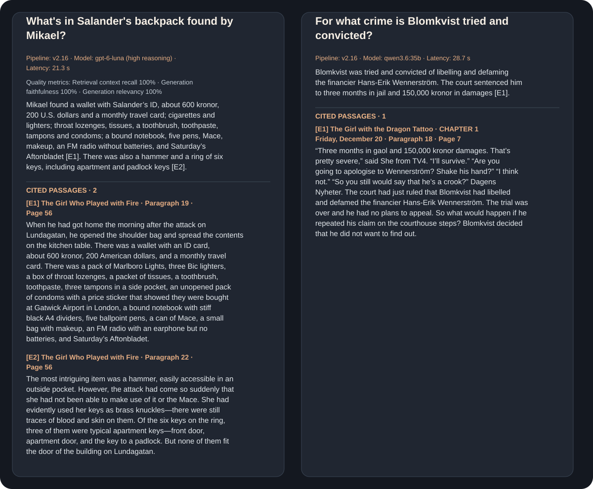

# 📚 Advanced RAG Pipeline

**[🌐 Try the pipeline](https://millennium.blaqc.space)**

This is a RAG pipeline developed for Novels, and storybooks.
Optimized for *Millennium* trilogy by Stieg Larsson.

- 🔍 Finds subtle details scattered across thousands of pages.
- 💭 Answers broad questions like “What special abilities does Salander have?”
- 📚 Can be adapted and optimized for different collections of documents.
- 🤖 Supports both local and API-based models.

**[🏆 Explore top-performing runs and metrics](docs/best-performing-versions.md)**

## How it works

The pipeline retrieves relevant passages from the books and uses them to generate answers with citations.



1. **Understand the question**
   - **Connection check:** Look for relevant entity-card information.
   - **Initial scene probe:** Search scene summaries for a likely match.
   - **True account checks:** Gather clues about deaths or crimes from entity cards, passages, and scenes.
   - **Sequence check:** Look for scenes describing a sequence of events.
   - **Moment check:** Look for a specific detail using scene summaries and keyword matching.
   - **Premise probe:** For a question that assumes someone was killed, look for evidence that they survived.

2. **Expand the query**
   - Generate a hypothetical passage with **HyDE**.
   - Generate three alternative queries.
   - Produce a grammar-corrected query.

3. **Search the books**
   - Search passages by meaning or keyword.
   - Search scenes and specific moments.
   - Look up names, entity cards, connections, and true accounts.

4. **Read and rerank evidence**
   - Read passages, scenes, or chapters for more context.
   - Rerank evidence using both the original question and the retrieval queries.

5. **Generate the answer**
   - Check minimum tool use, citation IDs, and coverage.
   - Verify that passages support the answer’s claims.
   - Check whether a sequence answer covers the necessary stages.
   - Synthesize from available evidence or abstain when needed.
   - Convert passage IDs into citation labels such as **[E1]**.
   - If a time, turn, or tool limit is reached, generate an answer from the compacted agent conversation without further tool calls.

### 📚 Indexing

The pipeline prepares the books for search using four indexes.

#### 📄 Passage index

Splits the books into passages and embeds them for search by meaning.

For example, a question about Salander’s bag can find a passage that calls it a “shoulder bag.”

**Actual entry, excerpt:**

```text
ID: 910a9f44-c857-5cc3-906c-6895da8c4b32
Book: The Girl Who Played with Fire
Paragraph: 19 · Page: 56
Text: “When he had got home the morning after the attack on Lundagatan,
      he opened the shoulder bag and spread the contents on the kitchen table.”
```

#### 🔤 Keyword index

Builds an in-memory index of passage word counts for BM25 search.

For example, searching for “wallet” can find passages containing that word.

**Actual word counts for the passage above, excerpt:**

```text
bag:     2
wallet:  1
kronor:  1
mace:    1
```

#### 🎬 Scene index

Embeds summaries of overlapping passages to help find scenes by meaning.

For example, a question about Modig interviewing Miriam Wu can find a summary of that scene.

**Actual entry, excerpt:**

```text
Summary: Faste tells Modig to stay away from an interview, accusing her
         of sabotage. Modig slaps Faste after he makes a comment about her
         interest in the interviewee. After Faste walks away, Modig returns
         to Miriam Wu. […]
Passages: 682589de-4e0d-4b52-6a13-2e19b2905db0
          705ac181-0591-aea8-914f-e01a5a15f650
          752e6a3e-1d76-804c-a237-4958c3111273
          5f344cd2-42fd-79df-feb2-e933269ae2f8
```

#### 👤 Entity cards

Store names, facts, and connections linked to passages.

For example, a card for Mikael Blomkvist brings together facts about him.

**Actual entry, excerpt:**

```text
Key: mikael blomkvist
Text: Mikael (person, nickname). first name of Blomkvist; another name for
      Blomkvist; name of Blomkvist. Mikael Blomkvist was handcuffed and
      uncomfortable. Mikael Blomkvist is the brother of Annika Giannini. […]
```

### 💬 Example questions



### ⚠️ Limitations

- Response times have not been optimized.
- Storage usage has not been optimized.
