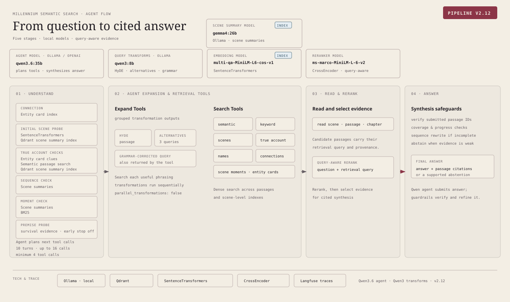

# Millennium semantic search

Ask questions about Stieg Larsson's *Millennium* trilogy and find answers grounded in the books. This project searches passages from locally supplied EPUBs, chooses the most relevant evidence, and uses a local language model to write an answer with citations. You can inspect the cited passages and the steps that produced the answer.

The book files are **not included** in this repository. The app builds its search index from EPUBs you place in the local `corpora/millennium/books/` directory.

## How it works

For a wider view, open the [book-inspired pipeline diagram](docs/pipeline-book-inspired.html) in a browser. The [style gallery](docs/pipeline-style-gallery.html) shows the other treatments using the same pipeline.

The default `full` mode runs six searches: the original query, one imagined answer passage (HyDE), three alternative phrasings, and one grammar-corrected query. If a short name can be completed from the books, a seventh search contributes extra results without changing the main fusion. A question asked in another language (most of its words are not ones the books use) is first translated into English, keeping names as written (a translated book title or nickname becomes the English edition's); the translation is searched too, and the rewrites, reranking and scene search use it. All searches use dense embeddings against Qdrant.

The embedding and reranking models run in the app process. `qwen3:8b` runs through Ollama for the fixed flow's search rewrites and final answer; Ollama can use a local GPU when one is available. When evidence looks weak, the pipeline can admit strong passages from the extra results and give the answer model more context. Some answers are a whole scene of dialogue in which no passage names the people involved; a second index of scene summaries (written once by `gemma4:26b` when the index is built) lets such a scene be found, and its passages are added after the usual evidence when its summary clearly beats the scenes the evidence already comes from. A `scene_moment` step handles questions about a detail at one moment ("what did she wear when they first met"): the model writes out the moment, searches the summaries with it and picks the scene that shows it. A passage that names neither the people nor the moment (often the line a chapter ends on, which is kept with the passage before it) is also searched for with the two sentences of its scene summary that describe it, and up to two such passages are added after the usual evidence. Released versions pin model names; endpoints remain deployment configuration. The web UI streams the answer as it is written, and the final answer cites the selected passages so you can check the source. The independent rewrite requests can run in parallel with the opt-in `parallel_transformations` setting.

The `/ask` endpoint defaults to the corpus-portable agentic `v2.12` pipeline, based on v2.8 and resolving its corpus profile and index from deployment configuration. It adds request-scoped query, embedding, search, reranking, and tool-read caches; cache hits and misses are traced in Langfuse. It adds premise checks, repeated-search progress feedback, and stricter answer verification. Premise-based early stopping is disabled by default in v2.12, while direct premise evidence remains available to answer synthesis. It supports optional `agent_provider`, `automatic_scene_search`, and `premise_early_stop` settings. For example, `{"pipeline":"v2.9","settings":{"agent_provider":"openai","automatic_scene_search":true}}` opts into both OpenAI GPT-6 Luna for the query agent and the automatic scene probe. Each setting can also be enabled on its own. Enabling automatic scene search uses a 30-candidate scene pool by default; the v2.2-compatible default remains 20 when the probe is off. Versions `v2.2` and `v2.7` remain selectable for comparison, and `v2.3` remains the standalone OpenAI query-agent experiment. Send `{"pipeline":"v2"}` to use the earlier agent flow or `{"pipeline":"v1"}` for the recorded fixed RAG flow. Both `/ask` and the Langfuse remote experiment payload accept `pipeline` and optional `settings` overrides. An override is recorded as a derived run, with its own `derived-` identity. The released flow definitions, prompt pins, index identity, and default are in [`pipelines.md`](pipelines.md); `pipelines.sha256` guards their fingerprints. On the 35 QA.csv questions the original agent scores 0.897 with a local fact judge (median 0.95, 30/35 at 0.9 or better), and it answers multi-hop questions the fixed pipeline gets wrong. See the [agentic retrieval experiment](docs/experiments/2026-10-19-agentic-rag.md).

## What Langfuse does here

Langfuse is the project's workspace for **prompts, traces, and experiments**:

- **Prompts:** The instructions for search rewrites and answers are versioned in Langfuse. A run pins the versions it used, so later prompt edits do not change that run's record.
- **Traces:** Each question records its search steps, retrieved passages, reranking, answer, and timing. The web app can show the trace for a question and send a helpfulness rating.
- **Experiments:** A question-and-answer dataset can be run through different pipeline settings. Langfuse links each answer to its trace and scores answer correctness and citation support, making runs easier to compare. Reference answers are used for evaluation, never to generate the answer. New runs use the fact-based `answer_correctness_v2` judge by default; the optional `answer_correctness_v3` runs through a local `opencode serve`.

The optional `answer_correctness_codex_v1` evaluator uses `gpt-5.6-luna` through `codex exec`. Each question starts a fresh ephemeral Codex session. Langfuse lists the evaluator as active using the local Ollama connection as a registry placeholder; the experiment worker sends judging requests to the host bridge at `CODEX_JUDGE_URL`. Run `python app/codex_judge_server.py` on the host with an authenticated Codex CLI before selecting this evaluator in an experiment. The trace contains a nested `gpt-5.6-luna` generation with input, cached input, and output token usage. Each score also includes the raw Codex counts; the bridge records the account's five hour usage percentage before and after each judge call when Codex exposes it. Experiment results include token totals and a per 100 question projection.

Langfuse helps explain *why* an answer changed when a prompt or search setting changes. The actual book search runs through Qdrant, and the language model calls run through Ollama.

Interactive questions use an optional persistent exact-answer cache. It only reuses answers for the same question and full pipeline/corpus identity, after the answer scores at least 0.90 for correctness or receives a thumbs-up. Citation-support scores do not affect eligibility. Dataset experiments bypass the cache unless the request opts in. Redis runs locally with persistent storage; cache status and source traces appear in Langfuse. See the [cache plan](docs/plans/2026-10-21-agent-v2.8-cache-and-latency.md) for controls and scoped maintenance commands.

## Explore the project

The web app is for asking questions; its UI lives in the [dragon-tattoo-oracle](https://github.com/kubilaycaglayan/dragon-tattoo-oracle) repository, included as the `frontends/millennium/ui` submodule (clone with `git clone --recurse-submodules`, or run `git submodule update --init` in an existing checkout). The Python API handles indexing, search, answers, and experiment runs. Corpus selection is controlled by `CORPUS_ID` and each `corpora/<id>/corpus.yaml`; corpus files, indexes, caches, and experiment artifacts are kept in corpus-specific paths. Langfuse is optional for interactive answering and indexing: set `LANGFUSE_ENABLED=false` or leave its credentials unset to run without tracing or hosted prompts. Hosted Langfuse experiments still require an enabled, configured Langfuse project. See the [technical guide](TECHNICAL_GUIDE.md) for setup and configuration, the [frontend guide](frontends/millennium/README.md) for the UI, and the [improvement log](docs/IMPROVEMENTS.md) for examples of how the pipeline was tuned.
