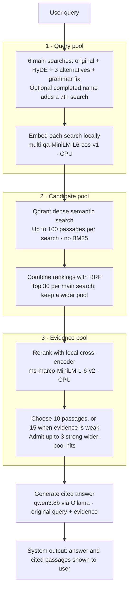

# Millennium semantic search

Ask questions about Stieg Larsson's *Millennium* trilogy and find answers grounded in the books. This project searches passages from locally supplied EPUBs, chooses the most relevant evidence, and uses a local language model to write an answer with citations. You can inspect the cited passages and the steps that produced the answer.

The book files are **not included** in this repository. The app builds its search index from EPUBs you place in the local `corpus/` directory.

## How it works

For a wider view, download the [standalone pipeline diagram](docs/pipeline-diagram.html) and open it in a browser. To compare visual treatments, open the [diagram style gallery](docs/pipeline-style-gallery.html); it shows six static styles and a step reveal using the same pipeline.

The default `full` mode runs six searches: the original query, one imagined answer passage (HyDE), three alternative phrasings, and one grammar-corrected query. If a short name can be completed from the books, a seventh search contributes to the wider candidate pool without changing the main fusion. All searches use dense embeddings against Qdrant; **BM25 keyword search is not part of the current pipeline**.

The embedding and reranking models run locally on CPU by default. `qwen3:8b` runs through Ollama for the search rewrites and the final answer. When evidence looks weak, the pipeline can admit strong passages from a wider pool and give the answer model more context. Model names and endpoints are configurable; the diagram shows the defaults. The final answer cites the selected passages so you can check the source.

## What Langfuse does here

Langfuse is the project's workspace for **prompts, traces, and experiments**:

- **Prompts:** The instructions for search rewrites and answers are versioned in Langfuse. A run pins the versions it used, so later prompt edits do not change that run's record.
- **Traces:** Each question records its search steps, retrieved passages, reranking, answer, and timing. The web app can show the trace for a question and send a helpfulness rating.
- **Experiments:** A question-and-answer dataset can be run through different pipeline settings. Langfuse links each answer to its trace and scores answer correctness and citation support, making runs easier to compare. Reference answers are used for evaluation, never to generate the answer.

Langfuse helps explain *why* an answer changed when a prompt or search setting changes. The actual book search runs through Qdrant, and the language model calls run through Ollama.

## Explore the project

The Vue web app is for asking questions. The Python API handles indexing, search, answers, and experiment runs. See the [technical guide](TECHNICAL_GUIDE.md) for setup and configuration, the [frontend guide](frontend/README.md) for the UI, and the [improvement log](IMPROVEMENTS.md) for examples of how the pipeline was tuned.
