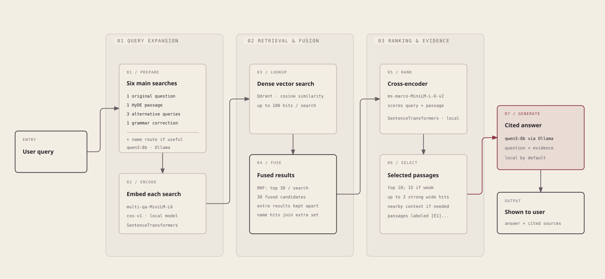

# Millennium semantic search

Ask questions about Stieg Larsson's *Millennium* trilogy and find answers grounded in the books. This project searches passages from locally supplied EPUBs, chooses the most relevant evidence, and uses a local language model to write an answer with citations. You can inspect the cited passages and the steps that produced the answer.

The book files are **not included** in this repository. The app builds its search index from EPUBs you place in the local `corpus/` directory.

## How it works

For a wider view, open the [book-inspired pipeline diagram](docs/pipeline-book-inspired.html) in a browser. The [style gallery](docs/pipeline-style-gallery.html) shows the other treatments using the same pipeline.

The default `full` mode runs six searches: the original query, one imagined answer passage (HyDE), three alternative phrasings, and one grammar-corrected query. If a short name can be completed from the books, a seventh search contributes extra results without changing the main fusion. A question asked in another language (most of its words are not ones the books use) is first translated into English, keeping names as written (a translated book title or nickname becomes the English edition's); the translation is searched too, and the rewrites, reranking and scene search use it. All searches use dense embeddings against Qdrant.

The embedding and reranking models run in the app process. `qwen3:8b` runs through Ollama for the search rewrites and the final answer; Ollama can use a local GPU when one is available. When evidence looks weak, the pipeline can admit strong passages from the extra results and give the answer model more context. Some answers are a whole scene of dialogue in which no passage names the people involved; a second index of scene summaries (written once by `gemma4:26b` when the index is built) lets such a scene be found, and its passages are added after the usual evidence when its summary clearly beats the scenes the evidence already comes from. A `scene_moment` step handles questions about a detail at one moment ("what did she wear when they first met"): the model writes out the moment, searches the summaries with it and picks the scene that shows it. A passage that names neither the people nor the moment (often the line a chapter ends on, which is kept with the passage before it) is also searched for with the two sentences of its scene summary that describe it, and up to two such passages are added after the usual evidence. Model names and endpoints are configurable; the diagram shows the defaults. The web UI streams the answer as it is written, and the final answer cites the selected passages so you can check the source. The independent rewrite requests can run in parallel with the opt-in `parallel_transformations` setting.

An experiment outside the default path gives a local model the same instruments as tools (`app/agent.py`); it answered a multi-hop Wennerström question the fixed pipeline gets wrong, but not the Salander-introduction question. See the [agentic retrieval experiment](docs/experiments/2026-10-19-agentic-rag.md).

## What Langfuse does here

Langfuse is the project's workspace for **prompts, traces, and experiments**:

- **Prompts:** The instructions for search rewrites and answers are versioned in Langfuse. A run pins the versions it used, so later prompt edits do not change that run's record.
- **Traces:** Each question records its search steps, retrieved passages, reranking, answer, and timing. The web app can show the trace for a question and send a helpfulness rating.
- **Experiments:** A question-and-answer dataset can be run through different pipeline settings. Langfuse links each answer to its trace and scores answer correctness and citation support, making runs easier to compare. Reference answers are used for evaluation, never to generate the answer. New runs use the fact-based `answer_correctness_v2` judge by default; the optional `answer_correctness_v3` runs through a local `opencode serve`.

Langfuse helps explain *why* an answer changed when a prompt or search setting changes. The actual book search runs through Qdrant, and the language model calls run through Ollama.

## Explore the project

The web app is for asking questions; its UI lives in the [dragon-tattoo-oracle](https://github.com/kubilaycaglayan/dragon-tattoo-oracle) repository, included as the `frontend/ui` submodule (clone with `git clone --recurse-submodules`, or run `git submodule update --init` in an existing checkout). The Python API handles indexing, search, answers, and experiment runs. See the [technical guide](TECHNICAL_GUIDE.md) for setup and configuration, the [frontend guide](frontend/README.md) for the UI, and the [improvement log](IMPROVEMENTS.md) for examples of how the pipeline was tuned.
