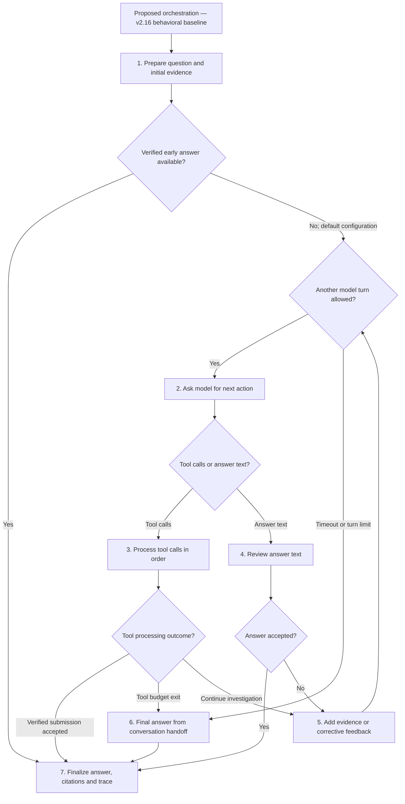

# Proposed agent graph

Date: 2026-11-25

**Status:** Design suggestion only. No implementation or new pipeline version is introduced.

**Behavioral baseline:** v2.16, the currently supported version in [the pipeline catalog](../pipelines.md). This graph proposes an orchestration structure around that behavior; it is not an exact executable specification.

See also the [adoption assessment](langgraph-refactor-assessment.md) for risks, alternatives, and preparation work.

## The idea in plain language

Keep one answering agent. Give it a clearly defined process: understand the question, gather initial evidence, choose what to investigate, use tools, and check the answer before returning it. When investigation runs out of time or allowance, use the existing conversation handoff to produce a final answer.

The boxes below are steps in that process, not separate autonomous agents. Most reuse existing Python functions. Only steps that already call a model need model calls.

## Suggested graph

Rectangles represent work; diamonds represent decisions. The loop means the agent can investigate again when evidence is insufficient.

This diagram groups some decisions for readability. In particular, tool processing includes submission verification, and finalization includes existing answer repair or synthesis behavior. The exact ordering described below must be preserved during an initial migration.

## What each step does

| Step | Human meaning | Existing code to reuse |
|---|---|---|
| 1. Prepare | Correct recognized name issues and gather useful context before asking the model. | `app/agent/prechecks.py`, initial scene probe in `app/agent/tools/scenes.py` |
| 2. Ask model | Let the model choose a tool or propose an answer using the current conversation. | `app/models/agent.py`, `app/agent/protocol.py` |
| 3. Process tools | Run requested tools sequentially, remember evidence, and handle `submit_answer` specially. | `app/agent/tools/dispatch.py`, `app/agent/submission.py` |
| 4. Review answer | Check whether answer text can be accepted or needs more investigation. | Existing no-tool branch in `app/agent/runner.py` |
| 5. Add feedback | Put tool results, name corrections, verification failures, or search-progress hints into the conversation. | Existing message builders and runner logic |
| 6. Conversation handoff | Produce an answer without further tool selection when a budget exit occurs. | `_forced_answer` and `app/context/agent_final_handoff.py` |
| 7. Finalize | Apply current finishing behavior and return the established result contract. | `_finish` and `app/answering/execution.py` |

The early-answer decision preserves `premise_early_stop`. It is disabled in the released v2.16 configuration. When enabled, a proposed direct premise resolution still requires verification.

## Important routing rules

### Preparation order

Use the actual runner order as the migration baseline:

1. Normalize the question and record name notes.
2. Run the connection precheck.
3. Run the optional initial scene probe and assemble its message.
4. Append the connection precheck message when applicable.
5. Run the true-account precheck.
6. Run the sequence precheck.
7. Run the moment precheck.
8. Run the premise probe.
9. Consider verified direct premise resolution if enabled.

These steps can initially remain inside one preparation node. Splitting them into individual nodes later is useful if separate inspection or recovery boundaries are needed. Do not parallelize them as part of the first migration.

### A model reply containing tools

- Preserve support for both structured calls and the existing parser for tool calls written as text.
- Assign missing call IDs as today and preserve message order.
- Execute calls one at a time. A model reply can contain more than one call.
- Treat recoverable tool failures as observations the model can use.
- Preserve name-correction messages and search-progress hints.
- A submission can finish the run immediately; do not execute remaining calls after an accepted submission.
- Preserve rejected-answer and verification branches before applying the existing tool-budget exit rule.

For the first implementation, process a whole reply's tool calls within one node. Persisting a cursor and splitting execution into one node invocation per tool is a later option if recovery between calls becomes a requirement.

### A model reply containing answer text

Preserve the current review sequence:

1. Extract citation IDs that refer to collected evidence.
2. Reject a previously rejected central answer.
3. Apply the minimum-tool nudge when its conditions hold.
4. Check evidence coverage and request further investigation if needed.
5. Verify the submission when citation IDs exist; reject unsupported claims.
6. Apply the no-tool nudge or request a supported answer when citations are absent.
7. Accept eligible answer text and finalize it.

The text-answer path and `submit_answer` path are not identical today. Keep their distinct rules initially instead of forcing both through a newly invented common policy.

### Budget exits

The diagram's budget decision summarizes the current turn-loop behavior. It does not propose a new universal guard before every operation.

- Timeout is checked at the start of a model turn.
- Turn exhaustion leads to conversation handoff.
- Tool-budget checking occurs within tool processing, after specific branches that can return or continue first.
- All three existing budget exits must retain the v2.16 conversation handoff.

A strict deadline before every tool, or uniform tool-limit enforcement across all branches, could be useful later. Those would be behavior changes and should be evaluated separately.

## What the graph needs to remember

The current `AgentState` is a starting point, but the conversation and local runner decisions also need explicit representation.

| State group | Contents | Why it matters |
|---|---|---|
| Run identity | Original and normalized question, corpus, collection, pipeline and configuration identity | Prevents mixing evidence or results from different runs |
| Conversation | Ordered messages, tool-call IDs and compacted results | Preserves what the model sees and the final handoff |
| Evidence | Passage records, insertion order, deliberate focus and retrieval queries | Preserves citation meaning and provenance |
| Progress | Turns, tool count, nudges, coverage checks and resolved names | Keeps loop decisions consistent |
| Review | Rejected answers, candidate answer and verification outcome | Prevents accepting unsupported answers on a later pass |
| Pending work | Model reply, requested calls and explicit next action | Makes routing understandable and testable |
| Result and telemetry | Final result, stop reason, trace and usage | Preserves API, experiment and observability contracts |
| Time budget | Explicit elapsed-time or deadline policy | Supports a future restart-safe budget model |

Keep network clients, callbacks, tracing handles, and other runtime resources outside persisted state. If persistence is enabled, define serialization and schema-version rules before storing checkpoints. A process-local `perf_counter()` value cannot serve as the cross-process deadline contract.

## Boundaries outside the graph

- **API and UI:** Continue calling the existing answering boundary and receiving its result shape and status events.
- **Retrieval and indexing:** Keep their current implementations; graph nodes call them through existing tools.
- **Provider adapters:** Keep current Ollama and OpenAI request formatting and response normalization.
- **Experiment scheduling:** Keep job scheduling separate from the graph for a single question.
- **Caching and identity:** Distinguish any experimental graph implementation from baseline results so cached answers cannot conceal behavioral differences.
- **Observability:** Preserve existing Langfuse observations and usage accounting while adding node-level visibility where useful.

## Suggested implementation sequence for later approval

1. Capture baseline transition tests and representative experiment results.
2. Extract preparation, one model turn, tool processing, text-answer review, and finalization into callable boundaries without changing their behavior.
3. Connect those boundaries with a custom graph and explicit routing decisions.
4. Compare the graph against the existing runner using the same inputs and mocked model/tool responses; then compare real evaluation results.
5. Only after parity, decide whether checkpointing, smaller nodes, human review, or parallel work justifies additional complexity.

Acceptance should cover citation validity, verification failures, name correction, tool errors, multiple calls in one reply, all budget exits, conversation handoff, output fields, and usage reporting. Real-model comparisons should also assess answer quality, latency, and cost; exact textual equality is not sufficient or always realistic.

**Recommended first milestone:** a graph that makes v2.16's decisions visible while preserving existing behavior. Multi-agent delegation, new reasoning strategies, parallel tool execution, and durable recovery remain separate follow-up decisions.
