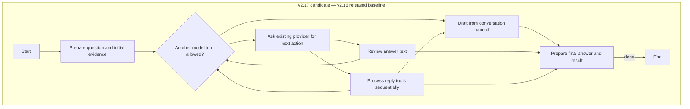

# Implemented v2.17 execution graph

<!-- Generated by python -m app.agent.graph_reference; do not edit by hand. -->

Target: **v2.17 candidate**, unregistered. Released catalog default: **v2.16**. This graph is available through `app.agent.execution.run_agent`; application routing and the released `app.agent.runner.run_agent` remain unchanged.

The diagram contains the actual compiled nodes and edges. Branch labels are the route values emitted by the extracted boundaries, not extra model calls or separate agents.

Tool processing handles one entire model reply in order. Rejected verification and previously rejected answers can continue within that node and bypass that call’s ordinary tool-budget check. Accepted submission skips remaining calls. Text review has its existing distinct nudge, coverage and verification rules.

Timeout, turn and tool exits reach budget drafting and then shared final preparation. The final result still reports `stopped=budget` for those exits. The `done` route terminates the graph. Provider exceptions propagate; recoverable tool errors stay observations. There is no automatic retry or universal fallback.

For T permitted model-selection turns, the longest path executes `1 + 3*T + 1 + 1 + 1 = 3*T + 4` nodes: preparation; T decide/select/review-or-tools cycles; the final turn-budget decision; budget drafting; final preparation. The invocation uses `recursion_limit = 3*T + 5`, allowing one additional framework halt step. Tool count does not add graph transitions because tools execute within one node. Application budgets, not the framework limit, select the handoff.

The graph carries the existing in-memory `ExecutionState` in a single channel and receives `AgentRuntime` through LangGraph runtime context. No message reducer, checkpoint, persistent store, prebuilt agent or parallel tool node is used.

Regenerate with `python -m app.agent.graph_reference`; check with `python -m app.agent.graph_reference --check`. Node implementations are in [execution.py](../app/agent/execution.py); graph wiring and the limit are in [graph.py](../app/agent/graph.py). Graph/node spans surround actual execution, and the answering/cache/experiment boundaries support an explicitly identified graph run. Candidate registration and live trace acceptance remain later roadmap steps.
